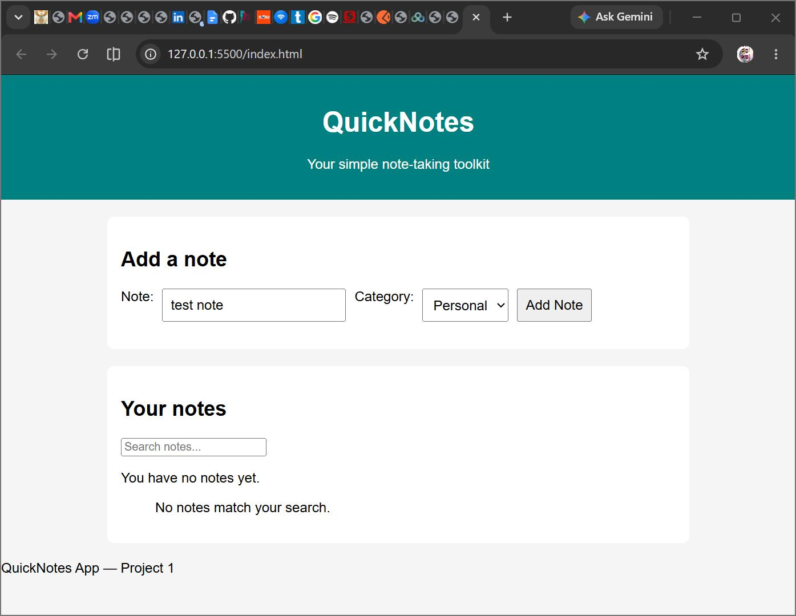
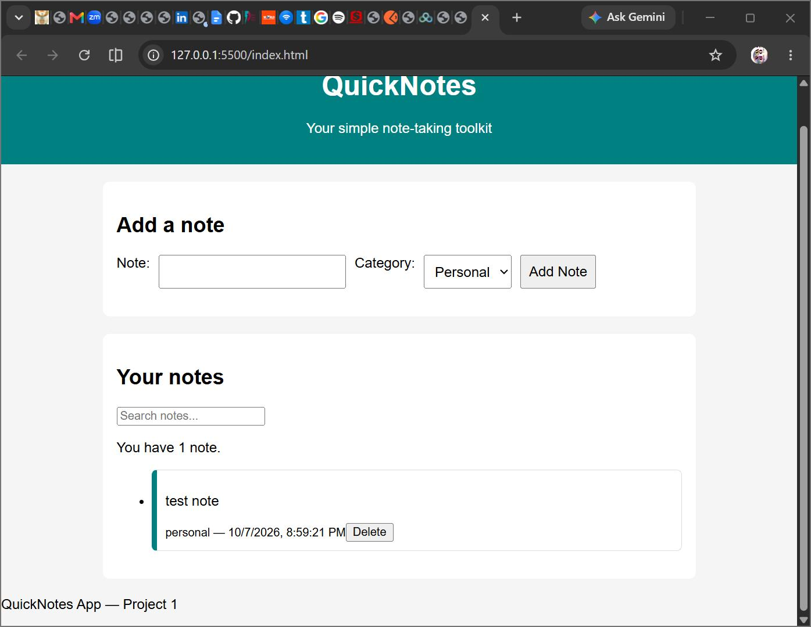
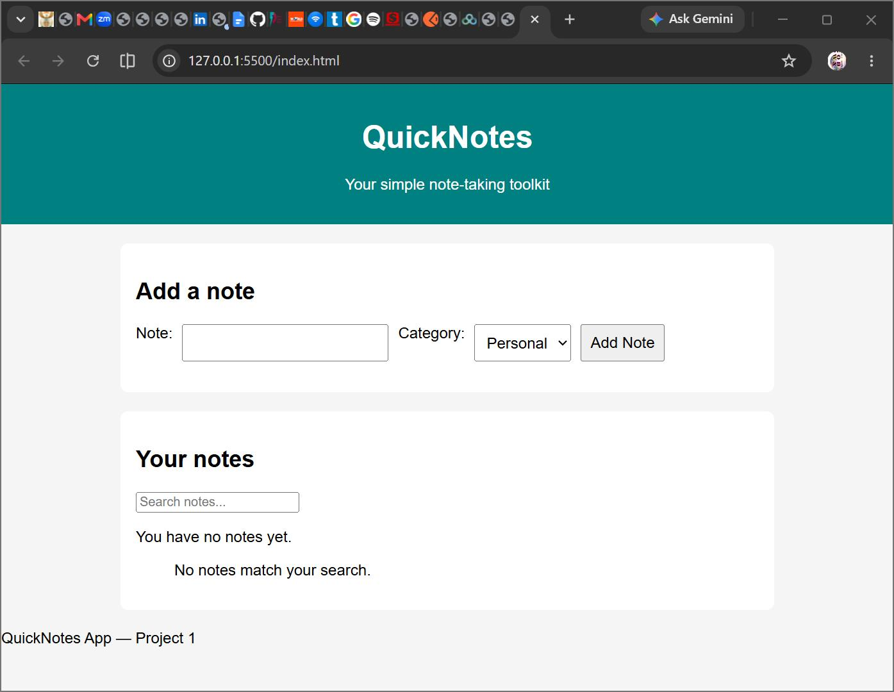

Here’s your **complete README.md** with the screenshot paths properly added so they’ll render inline on GitHub:

---

```markdown
# QuickNotes App — Project 1

## 📌 Description
QuickNotes is a browser‑based note‑taking application built as part of the Web Foundations course.  
It combines semantic HTML, responsive CSS, and dynamic JavaScript to provide a simple yet powerful tool for creating, categorizing, searching, and managing notes.  
All notes are saved in localStorage, ensuring they persist across page refreshes.

## ✨ Features
- Add notes with text, category, and timestamp.
- Delete notes individually.
- Search notes by keyword.
- Validation: prevents empty notes or notes over 200 characters.
- Category styling for personal, work, and study notes.
- Responsive design with Flexbox and media queries.
- Persistent storage using localStorage.
- Correct count message for zero, one, or many notes.

## 🚀 How to Run Locally
1. Clone the repository:
   ```bash
   git clone https://github.com/TwoOceans64/quicknotes-app
   ```
2. Open the folder in VS Code or your editor of choice.
3. Launch `index.html` using **Live Server** or open it directly in your browser.
4. Add, search, and delete notes — refresh to confirm persistence.

## 📸 Screenshots

**Add Note Form**  


**Note Added**  


**Note Deleted**  


## 📖 What I Learned
- **Semantic HTML**: Using `<header>`, `<main>`, `<section>`, and `<footer>` improves accessibility and structure.
- **Responsive CSS**: Flexbox layouts and media queries make the app usable on all screen sizes.
- **JavaScript DOM manipulation**: Creating elements with `createElement` and `appendChild` is safer than innerHTML.
- **Validation and feedback**: Handling errors gracefully with messages improves user experience.
- **Persistence with localStorage**: Saving and restoring notes ensures data survives refreshes.

---